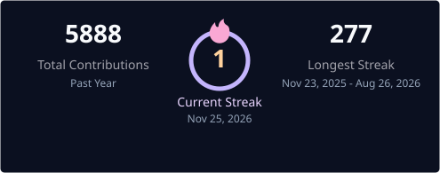

<h1 align="center">
  
</h1>

<p align="center">
  <a href="https://www.signaloninternet.com/">Portfolio</a> ·
  <a href="https://www.linkedin.com/in/signalinternet/">LinkedIn</a> ·
  <a href="mailto:sanket@signaloninternet.com">Email</a> ·
  <a href="#github-activity">GitHub activity</a>
</p>

I build web and mobile products end to end, from the interface and data model to payments, integrations, and deployment. My recent work includes checkout that recovers from interrupted payments, tools for teams running day-to-day operations, and AI assistants that cite the material they use.

## Selected work

- **Valora Valet** — Built the React Native staff app, Next.js admin console, and guest ticket flow. Saved payment requests and reconciled uncertain charges before allowing a new payment attempt. [Valora Valet](https://www.valoravalet.com/)
- **PsychExcel** — Built a course-grounded AI tutor with Python, FastAPI, and pgvector. It retrieves material the learner can access, cites sources, and validates feedback against mark schemes. [PsychExcel](https://psychexcel.com/)
- **Pariksha** — Built a PDF study companion that keeps files on-device and generates explanations, quizzes, and flashcards from selected excerpts. It checks source quotes before caching explanations. [Pariksha](https://pariksha.studio/)
- **Saleor** — Built an independent commerce product that connects inventory, orders, and invoicing. One business used it to manage inventory valued at more than **₹20 lakh**. [Saleor](https://www.saleor.city/)

## Experience

**Product Engineer · Ocean Wave Web** · Mar 2026 to present<br>
Built Valora Valet, connected stock allocation and invoicing for distributor.live, and built analytics dashboards backed by project-scoped APIs.

**Software Engineer, Web Platforms · Mediamaxxing LLC** · Nov 2025 to Feb 2026 · Contract<br>
Built Gemini-based quality and spam scoring for social video and an evaluation harness that compared generated edits with editor-approved references.

**Full-Stack Engineer · Ocean Wave Web** · Feb 2025 to Oct 2025 · Contract<br>
Shipped OceanWave Brain as the sole engineer, with four access roles, PostgreSQL row-level security, and Stripe Connect onboarding and webhook-driven payouts.

**Front-end Engineer · CyberFlux Enterprises** · Nov 2023 to Jan 2025<br>
Built reusable React components and responsive interfaces for healthcare and e-commerce products.

**Education** · B.Tech in Computer Science (AI & ML), Sanskriti University · Expected 2027 · 9.0 CGPA

## Technologies

| Area | Stack |
| --- | --- |
| Web & mobile | TypeScript, React, Next.js, React Native, Expo, Kotlin, Jetpack Compose |
| Backend & data | Python, FastAPI, C#, ASP.NET Core, Node.js, PostgreSQL, Supabase, Redis |
| Applied AI | RAG, pgvector, OpenRouter, Gemini, structured outputs, LLM evaluation |
| Integrations & delivery | Stripe Connect and Terminal, webhooks, AWS, Docker, GitHub Actions |

## GitHub activity

<!-- github-activity:start -->

**Public repos** 32 · **Stars earned** 1 · **Followers** 11

### Public commit activity

**81** commits across **9** repositories · 26 Nov 2025 to 25 Nov 2026

Times are in **Asia/Kolkata (IST)**. Counts cover distinct authored commits indexed by GitHub on public default branches.

**By time of day** · Four 6-hour windows starting at 06:00 IST

```text
Morning  4 ▌░░░░░░░░░░  4.9%
Daytime 28 ███▊░░░░░░░ 34.6%
Evening 27 ███▋░░░░░░░ 33.3%
Night   22 ███░░░░░░░░ 27.2%
```

**By weekday**

```text
Monday    16 ██▏░░░░░░░░ 19.8%
Tuesday   14 █▉░░░░░░░░░ 17.3%
Wednesday  4 ▌░░░░░░░░░░  4.9%
Thursday  13 █▊░░░░░░░░░ 16.0%
Friday    13 █▊░░░░░░░░░ 16.0%
Saturday  11 █▌░░░░░░░░░ 13.6%
Sunday    10 █▍░░░░░░░░░ 12.3%
```

### Languages in public repositories

Share of code by byte count, across owned public repositories excluding forks.

```text
TypeScript ███████▍░░░ 66.8%
JavaScript ██▏░░░░░░░░ 19.8%
CSS        ▋░░░░░░░░░░  5.3%
Python     ▌░░░░░░░░░░  5.1%
HTML       ▎░░░░░░░░░░  2.7%
Other      ░░░░░░░░░░░  0.4%
```

_Updated 26 Nov 2026 via the GitHub API._

<!-- github-activity:end -->

<!-- coding-time:start -->
<!-- coding-time:end -->

<details>
<summary>GitHub contribution streak</summary>
<br />
<a href="https://github.com/signaloninternet#contributions">
  
</a>
<br />
<a href="https://streak-stats.demolab.com/?user=signaloninternet&amp;mode=weekly">View weekly streak</a>
</details>
